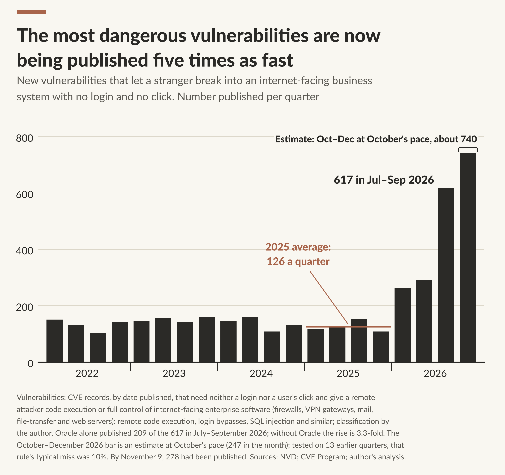
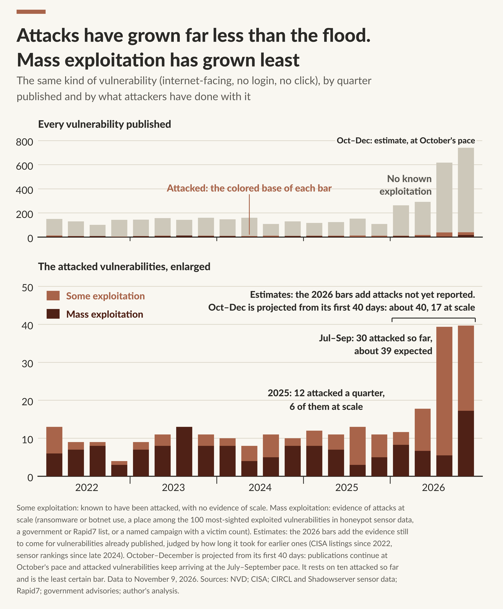
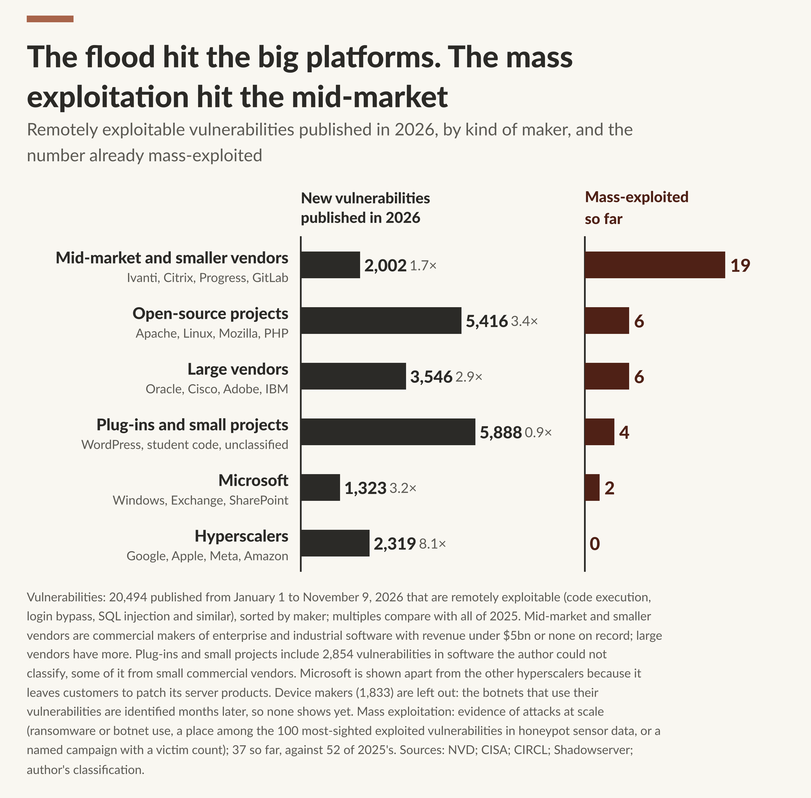
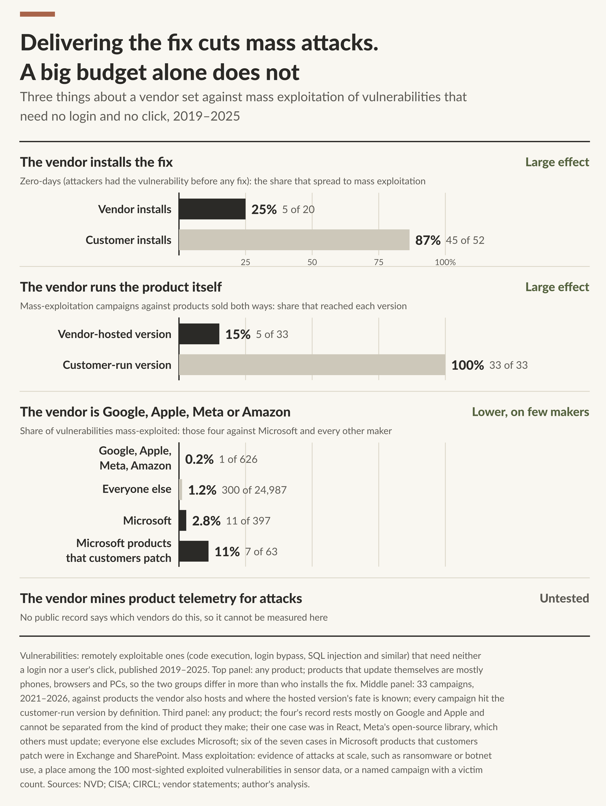
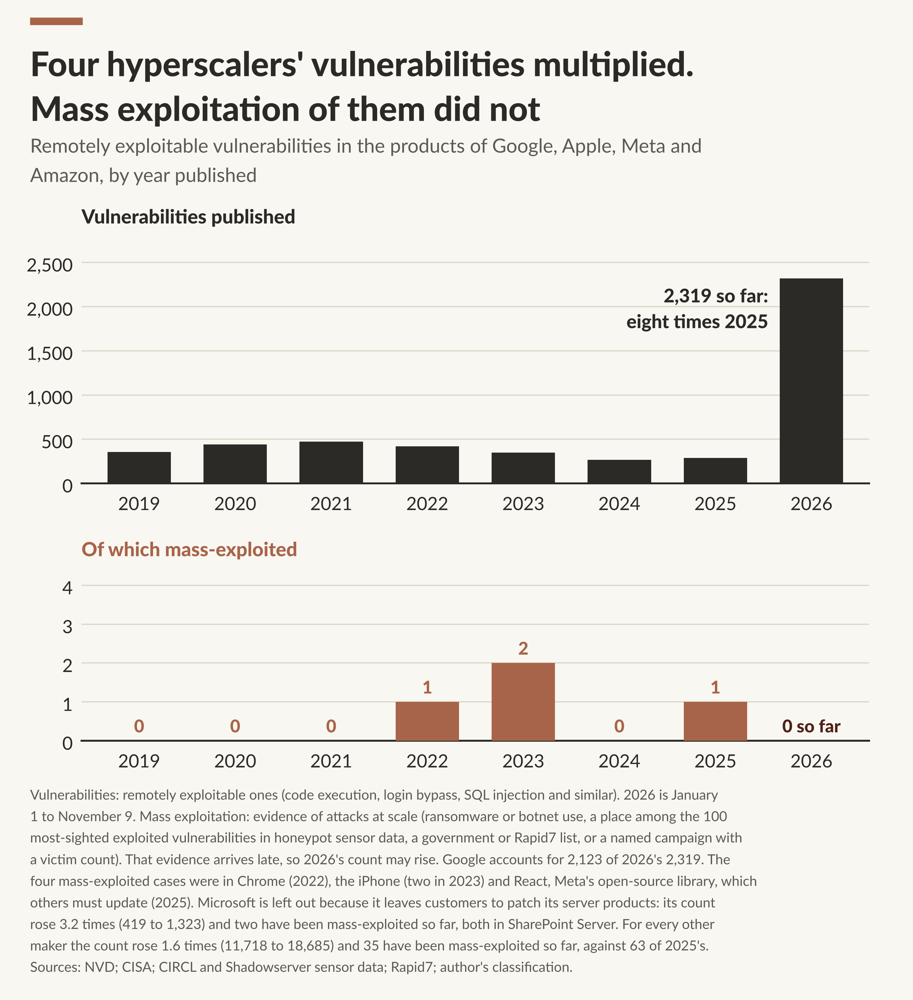
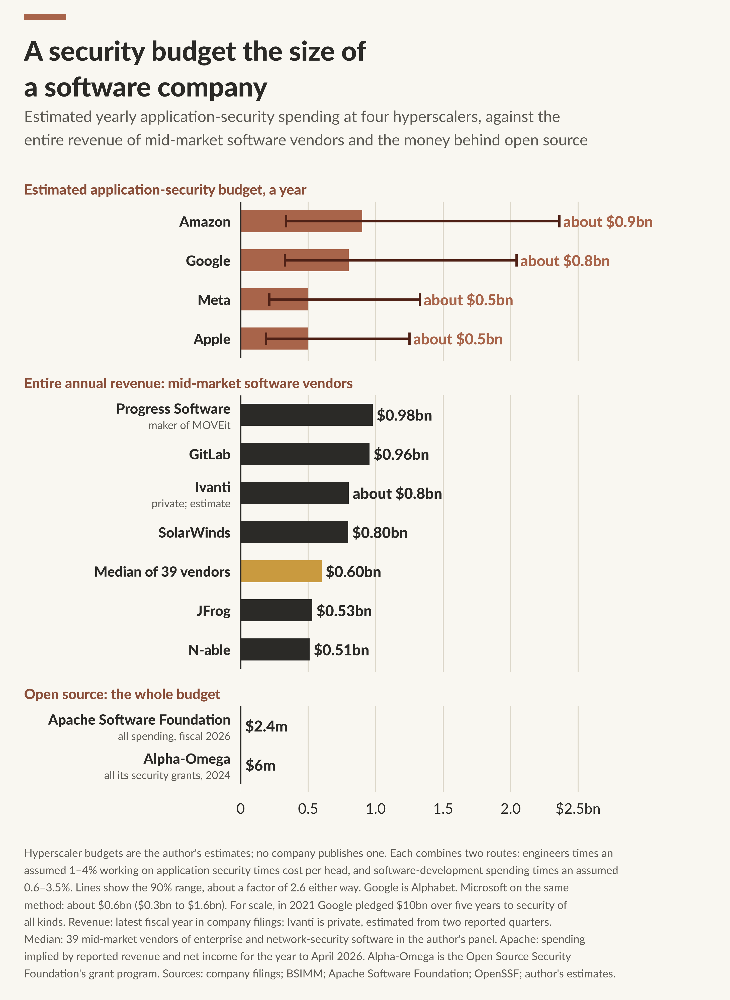
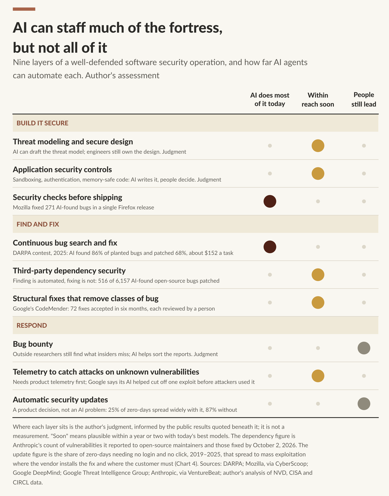
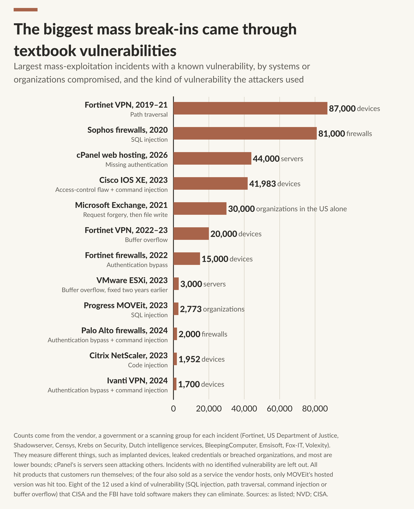

# Solutions to the vulnpocalypse are here: data and code

Companion repository for the essay **"Solutions to the vulnpocalypse are here. They're just not evenly distributed"** by Joshua Saxe (November 2026). Post: [Read the essay on Substack](https://joshuasaxe181906.substack.com/p/solutions-to-the-vulnpocalypse-are).

It contains the frozen data behind the essay, the code that draws all eight charts, and a script that recomputes every number quoted in the text. Nothing here needs a network connection or an API key.

The essay asks who is benefiting from the surge in newly discovered software vulnerabilities. Its answer, from public data: attackers are benefiting less than the surge suggests, the damage is concentrated in mid-market and smaller vendors whose customers must install fixes themselves, and the four hyperscalers that run or update most of what they ship (Google, Apple, Meta, Amazon) have so far kept mass exploitation of their own vulnerabilities near zero.

**This is a sketch built from late and incomplete public evidence, not a measurement.** Read [LIMITATIONS.md](LIMITATIONS.md) before quoting any number.

## The figures, and how each number was made

Every figure below is redrawn by `python run_all.py`. "The class" means the most dangerous kind of vulnerability: exploitable over a network with no login and no click, in internet-facing enterprise software (firewalls, VPN gateways, mail, file-transfer and web application servers). "Remotely exploitable" is the wider set: anything described as remote code execution, or rated by CVSS as network-reachable with high impact on confidentiality, integrity and availability. Dates are always the date the vulnerability was **published**.

### 1. New vulnerabilities of the most dangerous class, by quarter



- **What is counted.** CVE records in the class, by quarter published. 505 in 2025 (126 a quarter); 617 in July to September 2026, 4.9 times the 2025 average. One vendor, Oracle, published 209 of those 617.
- **What is estimated.** The October to December bar. The quarter was 40 days old at the snapshot, so the bar is October's count times three (247 x 3 = 741; range 581 to 940). Tested on 13 earlier quarters, that rule was 1% high in total with a typical miss of 10%.
- **"Roughly 4x this year"** in the post is 1,913 expected for 2026 against 505 in 2025 (3.8x).
- **Sources.** National Vulnerability Database and CVE Program records. Script: `src/chart1.py`.

### 2. How many of those were attacked



- **What is counted.** The same class, by quarter published, split three ways. *Attacked* means there is public evidence the vulnerability was exploited at all: it is in CISA's Known Exploited Vulnerabilities catalog, or named in one of the researched lists of exploited vulnerabilities, or meets the mass-exploitation test. *Mass exploitation* means public evidence of scale: ransomware or botnet use, a government or Rapid7 list of widely exploited vulnerabilities, a place in a quarterly top-100 honeypot sighting list, or a named campaign with a victim count.
- **It is a count by cohort, not a rate and not a count of attacks.** The 2025 bars say how many vulnerabilities *published in 2025* have been attacked at any time since: 47, of which 23 at scale.
- **What is estimated.** Everything in 2026. Evidence arrives after publication (63% of CISA listings come within 30 days of publication, 86% within 180), so each recent quarter's observed count is divided by the share of evidence expected to have arrived. Observed so far for 2026: 66 attacked, 23 at scale. Estimated: about 108 attacked (90% range 89 to 148) and about 38 at scale (26 to 64).
- **"Exploitation more like 2x"** in the post is 108 against 47 (2.3x). Because publication of the class rose about 4x, the share of new vulnerabilities that get attacked has fallen.
- **How well the estimate works.** Run as of day 40 of 13 past quarters, the attacked estimate was 1% high in total and missed single quarters by 19% on average (worst: 84% high). The mass-exploitation estimate could not be tested, because the sensor record starts in October 2024.
- **Sources.** NVD; CISA's catalog (with listing dates and ransomware flags); CIRCL's quarterly sighting rankings, which draw on Shadowserver honeypots; government advisories, Rapid7 reports and vendor and press reports, each listed with its URL in `pipeline/inputs/source_documents.csv`. Scripts: `src/chart2.py`, `src/estimates.py`.

### 3. Where the flood and the mass exploitation landed



- **What is counted.** All remotely exploitable vulnerabilities published January 1 to November 9, 2026, by kind of maker, and how many of each already count as mass-exploited. These are observed counts with no adjustment. Mid-market and smaller vendors: 2,002 published, 19 mass-exploited. The four hyperscalers: 2,319 and none. All makers shown: 20,494 and 37.
- **How makers are grouped.** By revenue where a figure exists (under or over $5bn), otherwise by the kind of product. About 1,800 vendor names in the mid-market group have no revenue on record, and half of "plug-ins and small projects" is software that could not be classified. `LIMITATIONS.md` items 6 to 8 give the result under other groupings.
- **Device makers are left out**, because the botnets that use router and camera vulnerabilities are identified months later.
- **Sources.** As Chart 2, plus company filings for revenue (`data/vendor_panel.csv`). Script: `src/chart3.py`.

### 4. Who installs the fix, who runs the product, who makes it



- **Top panel.** Zero-days (vulnerabilities attackers were using before a fix existed) with no login and no click, published 2019 to 2025. Where the vendor installs the fix, 5 of 20 went on to mass exploitation; where the customer installs it, 45 of 52.
- **Middle panel.** Of 121 researched mass-exploitation campaigns, 33 hit products the vendor also sells as a hosted service. The hosted version was hit in 5.
- **Bottom panel.** Share of no-login, no-click vulnerabilities (2019 to 2025) that count as mass-exploited: the four hyperscalers 1 of 626, everyone else 300 of 24,987, Microsoft 11 of 397, Microsoft products customers patch 7 of 63.
- **This is observational, on small numbers.** The groups differ in more than who installs the fix.
- **Sources.** Who installs the fix was researched for 62 product families (`pipeline/inputs/update_models_major_products.csv`) and inferred from product type for the rest. Campaigns: `data/campaigns.csv`. Script: `src/chart4.py`.

### 5. The four hyperscalers, year by year



- **What is counted.** Remotely exploitable vulnerabilities published by Google, Apple, Meta and Amazon each year (287 in 2025; 2,319 so far in 2026, of which Google 2,123), and those that count as mass-exploited (four since 2019; none of 2026's so far).
- **Caveat.** Their products are mostly phones and browsers, which honeypot sensors cannot see, so for them only ransomware reports, government lists and named campaigns count, and those arrive late.
- **Script.** `src/chart5.py`.

### 6. Application-security budgets against mid-market revenue



- **These are estimates. No company publishes this number.** Each is built two ways and pooled: (A) engineers x the share working on application security (1% to 4%) x cost per head ($280,000 to $570,000) x overhead (1.1 to 1.6); (B) software-development spending x the share spent on application security (0.6% to 3.5%).
- **Results.** Amazon $0.9bn, Google $0.8bn, Meta $0.5bn, Apple $0.5bn, each with a range of about a factor of 2.6 either way. Median revenue of the 39 mid-market vendors in the panel: $0.6bn.
- **Sources.** Head counts and R&D spending from annual filings (`data/budget_inputs.csv`); the assumed shares and their basis are in `data/budget_assumptions.csv`. Scripts: `src/budgets.py`, `src/chart6.py`.

### 7. Nine layers of defense and how far AI automates each



- **A judgment, not a measurement.** The placements are the author's. The public result quoted under each layer is real and cited in `data/layers.csv`.

### 8. The largest mass-exploitation incidents



- **What is counted.** The twelve largest campaigns with a published count of compromised systems or organizations and an identified vulnerability. Counts are quoted as their sources give them and measure different things, so the unit is on each bar.
- **Sources.** One cited report per bar, in `data/campaigns.csv`.

## Questions people ask

**Is "exploitation up 2x" a count of KEV entries, an exploitation rate, or something else?** A count, by cohort. It is the number of vulnerabilities in the class (no login, no click, internet-facing enterprise software) with public evidence of exploitation, grouped by the year the vulnerability was published: 47 for 2025, about 108 estimated for 2026. CISA's catalog is the main evidence, joined by government "most exploited" lists, Rapid7's reports, sensor rankings and named campaigns. The 2026 figure is scaled up for reporting delay, measured on CISA's listing dates.

**So is the exploitation rate up or down?** Down, per vulnerability. About 9% of the class published in 2025 has been attacked (47 of 505); the estimate for 2026 is about 6% (108 of 1,913). More vulnerabilities are attacked, a smaller share of them.

**Where does the mass-exploitation data come from?** No single source. `pipeline/inputs/source_documents.csv` lists all 189 documents: 90 used as evidence of wide exploitation and 99 used for campaign victim counts. `METHODOLOGY.md` section 4 has the exact rule.

**Why only remote vulnerabilities?** Honeypot sensors make their exploitation observable. Privilege escalation and lateral movement happen inside networks where almost nothing is published.

**Why trust the 2026 numbers?** Treat them as estimates with wide ranges. The back-tests are in `METHODOLOGY.md` section 5 and `output/estimates.json`.

## Run it

```
python -m venv .venv && source .venv/bin/activate
pip install -r requirements.txt
python run_all.py
```

The run takes two to three minutes and needs Python 3.12 or newer, numpy and matplotlib. It writes:

| Output | What it is |
|---|---|
| `output/chart1_…png` to `output/chart8_…png` | The eight charts, 2,912 pixels wide |
| `output/chartN_numbers.json` | Every number drawn on chart N |
| `output/estimates.json` | The 2026 estimates, their ranges and the back-tests |
| `output/budget_estimates.json`, `output/maturity.json` | Chart 6's budget estimates; the vendor-attribute tests |
| `NUMBERS.md`, `output/numbers.json` | Every statement with a number in the text of the post, the value the data give, and whether the wording still holds (`yes` or `CHECK`) |

The files in `output/` and `NUMBERS.md` are committed, so you can read them without running anything. Running `run_all.py` regenerates them; the JSON files should come out identical (the bootstrap uses a fixed seed), and the images identical or nearly so, depending on your matplotlib version.

Each script in `src/` also runs on its own, for example `python src/chart3.py`.

## Where each claim is computed

| In the post | Script | Numbers |
|---|---|---|
| Chart 1: the most dangerous vulnerabilities are being published five times as fast | `src/chart1.py` | `output/chart1_numbers.json` |
| Chart 2: attacks have grown far less than the flood; the 2026 estimates | `src/chart2.py`, `src/estimates.py` | `output/estimates.json` |
| Chart 3: where the vulnerabilities and the mass exploitation landed, by kind of maker | `src/chart3.py` | `output/chart3_numbers.json` |
| Chart 4: who installs the fix, who runs the product, who makes it | `src/chart4.py` | `output/chart4_numbers.json` |
| Chart 5: the four hyperscalers, year by year | `src/chart5.py` | `output/chart5_numbers.json` |
| Chart 6: application-security budgets against mid-market revenue | `src/chart6.py`, `src/budgets.py` | `output/chart6_numbers.json` |
| Chart 7: nine layers of defense and how far AI automates each (a judgment, not a measurement) | `src/chart7.py`, `data/layers.csv` | `output/chart7_numbers.json` |
| Chart 8: the largest mass-exploitation incidents | `src/chart8.py` | `output/chart8_numbers.json` |
| Every number in the running text and the methodology section | `src/post_numbers.py` | `NUMBERS.md` |
| "I also tested bug bounties, the Secure by Design pledge…" | `src/maturity.py` | `output/maturity.json` |

## What is in the repository

```
README.md             this file
METHODOLOGY.md        how every label, count and estimate is made
LIMITATIONS.md        what the data cannot support, stated plainly
DECISIONS.md          the choices made along the way, why, and what the alternatives show
DATA_DICTIONARY.md    every file in data/ and every column
NUMBERS.md            generated: each statement in the post against the data
run_all.py            rebuilds everything
requirements.txt
data/                 the frozen tables (see DATA_DICTIONARY.md)
src/
  study.py            loads the data; the definitions used everywhere (the class, mass exploitation, maker groups)
  estimates.py        reporting-delay curves, the 2026 estimates, their ranges and back-tests
  budgets.py          application-security budget estimates
  maturity.py         vendor attributes against mass exploitation, with vendor-clustered permutation tests
  chart1.py … chart8.py
  post_numbers.py     recomputes each statement in the post and marks it supported or not
  style.py            the chart style
fonts/                Lato, under the SIL Open Font License (fonts/OFL.txt)
output/               generated charts and numbers
pipeline/             provenance: how data/ was built from the raw sources (not runnable from here; see pipeline/README.md)
```

## The data in one paragraph

`data/flaws.csv.gz` has one row for each of 78,992 CVE records published from January 1, 2019 that are either described as remote code execution or rated by CVSS as reachable over a network with high impact on confidentiality, integrity and availability. The study uses the 78,980 published up to November 9, 2026. Each row carries what the vulnerability allows, whether it needs a login or a user's click, what kind of product it is in, who makes that product, who installs the fix, and what public evidence there is that it was attacked and at what scale. The records are from the National Vulnerability Database and the CVE Program; the labels are the author's, made with rules, research tables and heavy AI assistance, and some of them are wrong. Hand corrections are listed in `data/group_overrides.csv` and `data/role_overrides.csv`.

## The five caveats that matter most

1. **Only remote vulnerabilities are counted**, because honeypot sensors make their exploitation observable. Privilege escalation, lateral movement, stolen credentials and misconfigurations are outside the study.
2. **"Mass exploitation" is a floor built from public evidence** (ransomware and botnet reports, sensor rankings, government lists, named campaigns). Quiet, targeted use is mostly invisible, and the kind of evidence available differs between older and newer vulnerabilities.
3. **The 2026 exploitation numbers are estimates.** Evidence arrives months late; the last bar of Chart 2 is three-quarters projection, and the mass-exploitation estimate could not be back-tested.
4. **Counting vulnerabilities is not counting risk.** Nothing here accounts for how widely software is deployed, and vulnerability counts follow vendors' disclosure habits.
5. **The comparisons between makers are observational, on small numbers, and the model group of four hyperscalers was chosen after looking at the data.**

## Changing things

- Definitions (the class, what counts as mass exploitation, maker-group names): `src/study.py`.
- A maker filed in the wrong group, or a product in the wrong role: add a line to `data/group_overrides.csv` or `data/role_overrides.csv`. These are applied when the snapshot is built (`pipeline/build_snapshot.py`), so a new line takes effect only on a rebuild from the upstream files; to try a change without them, edit `grp()` in `src/study.py`.
- Budget assumptions: `data/budget_assumptions.csv` and `data/budget_inputs.csv`.
- Chart 7's placements: `data/layers.csv`.

After any change, `python run_all.py` redraws the charts and `NUMBERS.md` shows which statements in the post no longer hold.

## Sources and terms

Vulnerability records: [National Vulnerability Database](https://nvd.nist.gov/) and the [CVE Program](https://www.cve.org/). Exploitation evidence: [CISA's Known Exploited Vulnerabilities catalog](https://www.cisa.gov/known-exploited-vulnerabilities-catalog); [CIRCL's vulnerability-lookup](https://vulnerability.circl.lu/) sighting rankings, which draw on [Shadowserver's honeypot sensors](https://dashboard.shadowserver.org/statistics/honeypot/monitoring/vulnerability/); government advisories; Rapid7's reports; and press and vendor reports of named campaigns, each cited by URL in `data/campaigns.csv` and `pipeline/inputs/exploitation_evidence_lists.csv`. Company figures are from annual filings, cited in `data/budget_inputs.csv` and `data/vendor_panel.csv`. Each source remains under its own terms.

The charts are set in Lato, © tyPoland Łukasz Dziedzic, distributed under the SIL Open Font License 1.1 (`fonts/OFL.txt`).

## License

_To be chosen by the author before this repository is made public._ A common pairing is MIT for the code and CC BY 4.0 for the data tables, charts and text.

## Citing

Joshua Saxe, "Solutions to the vulnpocalypse are here. They're just not evenly distributed", November 2026, with data and code at this repository.
